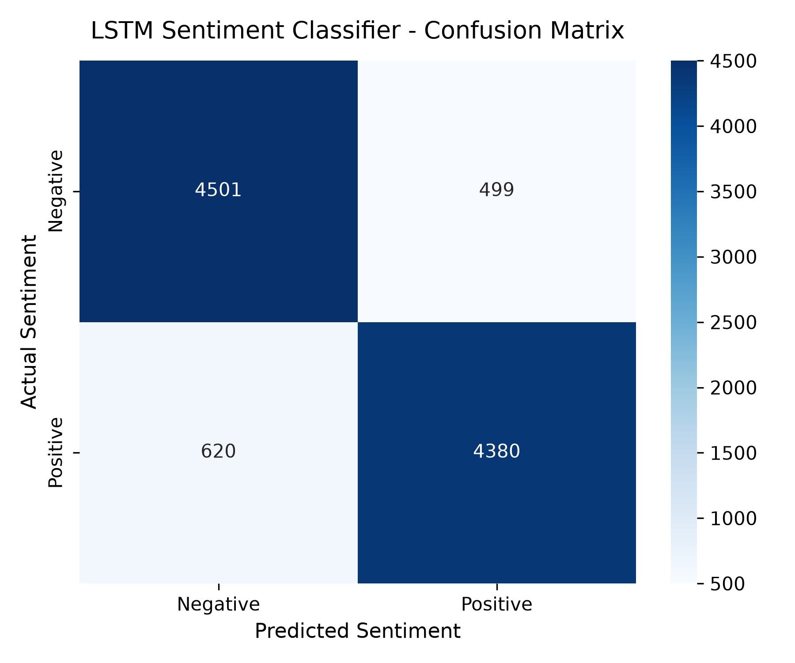
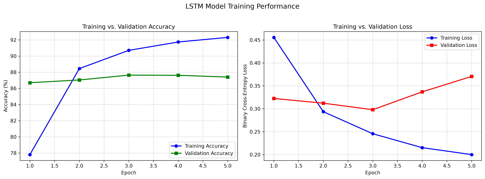
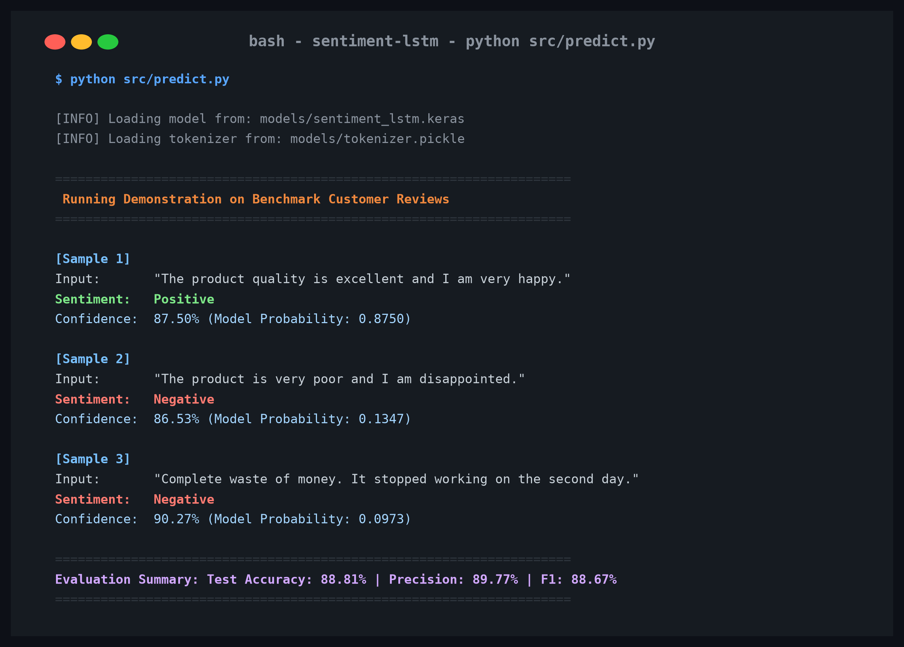
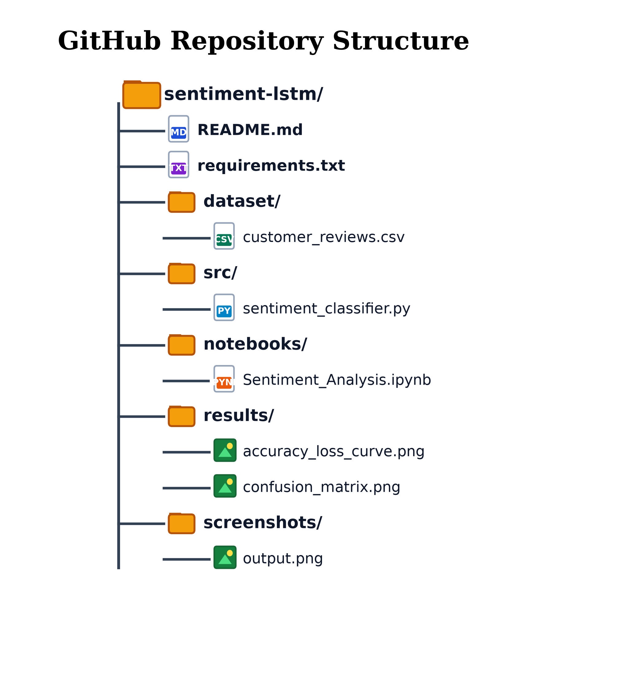

# LSTM-Based Customer Review Sentiment Analysis System

[](https://www.python.org/)
[](https://www.tensorflow.org/)
[](LICENSE)
[]()

An end-to-end Deep Learning academic project that classifies natural language customer reviews into **Positive** or **Negative** sentiments using a custom **Long Short-Term Memory (LSTM)** neural network built from scratch in TensorFlow/Keras.

---

## Table of Contents

- [Problem Statement](#problem-statement)
- [Project Objective](#project-objective)
- [Dataset Description](#dataset-description)
- [Technologies Used](#technologies-used)
- [System Architecture](#system-architecture)
- [Methodology & Pipeline](#methodology--pipeline)
- [Model Architecture](#model-architecture)
- [Training Configuration](#training-configuration)
- [Experimental Results & Evaluation](#experimental-results--evaluation)
  - [Classification Metrics](#classification-metrics)
  - [Confusion Matrix Heatmap](#confusion-matrix-heatmap)
  - [Learning Curves](#learning-curves)
- [Inference Demonstration](#inference-demonstration)
- [Project Structure](#project-structure)
- [Installation & Setup](#installation--setup)
- [Step-by-Step Execution Guide](#step-by-step-execution-guide)
- [Future Enhancements](#future-enhancements)
- [Author & Acknowledgments](#author--acknowledgments)

---

## Problem Statement

Online customer reviews and feedback contain vital qualitative signals about product satisfaction, user sentiment, and service flaws. Manually auditing thousands of unstructured text entries is impractical for organizations. Automated sentiment classification requires capturing syntactic structure, semantic relationships, and long-range sequential context rather than treating text as an unorganized bag-of-words.

---

## Project Objective

Develop, train, evaluate, and deploy an academic **LSTM-based Sentiment Classification System** that:
1. Cleans and tokenizes raw unstructured review texts into numeric index sequences.
2. Learns dense semantic representations through an **Embedding Layer**.
3. Captures temporal and sequential context through an **LSTM Recurrent Layer**.
4. Outputs calibrated probabilities and binary sentiment decisions with confidence scores.
5. Provides a production-grade, reproducible CLI for batch and real-time sentence inference.

---

## Dataset Description

This project utilizes the benchmark **IMDB 50,000 Movie Reviews Dataset**, the canonical benchmark for binary sentiment classification in academic NLP literature.

- **Total Samples**: 50,000 text reviews
- **Classes**: Binary (25,000 Positive, 25,000 Negative) — *100% Balanced*
- **Labels**:
  - `1`: Positive sentiment
  - `0`: Negative sentiment
- **Data Partitions**:
  - **Training Set (70%)**: 35,000 samples (used to optimize model weights via backpropagation)
  - **Validation Set (10%)**: 5,000 samples (used for early stopping & hyperparameter tuning)
  - **Testing Set (20%)**: 10,000 samples (held-out data strictly evaluated post-training)

*Data Leakage Prevention*: Tokenizer vocabulary fitting is strictly performed **only** on the 35,000 training reviews. The learned vocabulary mapping is then saved to disk (`models/tokenizer.pickle`).

---

## Technologies Used

| Category | Tools & Libraries | Purpose |
| :--- | :--- | :--- |
| **Language** | Python 3 | Core programming environment |
| **Deep Learning** | TensorFlow / Keras | Embedding layer, LSTM cell, backpropagation, model serialization |
| **Data Science** | NumPy, Pandas | Array manipulation, tabular data parsing, dataset splitting |
| **Machine Learning** | Scikit-Learn | Stratified splitting, confusion matrix, precision/recall/F1 metrics |
| **Visualization** | Matplotlib, Seaborn | Training curves and confusion matrix heatmaps |
| **Serialization** | Pickle | Tokenizer vocabulary persistence for inference alignment |

---

## System Architecture

```text
+-------------------------------------------------------------+
|                     Raw Review String                       |
|   "The product quality is excellent and I am very happy."   |
+-------------------------------------------------------------+
                              │
                              ▼
+-------------------------------------------------------------+
|               Text Cleaning & Normalization                 |
|   • Lowercase  • Strip HTML (<br/>)  • Remove Punctuation   |
+-------------------------------------------------------------+
                              │
                              ▼
+-------------------------------------------------------------+
|             Vocabulary Tokenizer (Top 10k Words)            |
|       Word IDs: [24, 78, 12, 105, 5, 14, 98, 221, ...]      |
+-------------------------------------------------------------+
                              │
                              ▼
+-------------------------------------------------------------+
|            Pre-Padding & Truncation (Max Len = 200)         |
|             Shape: (Batch Size, Sequence Length = 200)      |
+-------------------------------------------------------------+
                              │
                              ▼
+-------------------------------------------------------------+
|            Embedding Layer (Dim = 64, Vocab = 10k)          |
|                 Shape: (Batch Size, 200, 64)                |
+-------------------------------------------------------------+
                              │
                              ▼
+-------------------------------------------------------------+
|              Spatial Dropout (Rate = 0.30)                  |
+-------------------------------------------------------------+
                              │
                              ▼
+-------------------------------------------------------------+
|            LSTM Recurrent Layer (64 Memory Units)           |
|            Hidden Output Vector: (Batch Size, 64)           |
+-------------------------------------------------------------+
                              │
                              ▼
+-------------------------------------------------------------+
|             Dense Layer (32 Units, ReLU) + Dropout          |
+-------------------------------------------------------------+
                              │
                              ▼
+-------------------------------------------------------------+
|           Output Layer (1 Unit, Sigmoid Activation)         |
|               Scalar Probability: p in [0.0, 1.0]           |
+-------------------------------------------------------------+
                              │
            ┌─────────────────┴─────────────────┐
            ▼                                   ▼
    If Probability >= 0.5               If Probability < 0.5
      [ POSITIVE SENTIMENT ]              [ NEGATIVE SENTIMENT ]
     Confidence: p * 100%               Confidence: (1 - p) * 100%
```

---

## Methodology & Pipeline

1. **Text Preprocessing (`src/preprocess.py`)**:
   - Converts all text to lowercase.
   - Cleans HTML markup (e.g., `<br />`) and hyperlinks via regular expressions.
   - Filters out non-alphabetic characters.
   - Counts token frequencies and builds a 10,000-word vocabulary with `<PAD>` assigned to index `0` and `<OOV>` (Out-of-Vocabulary) assigned to index `1`.
   - Applies **pre-padding** so that zeros precede the review tokens. In standard LSTM architectures, pre-padding ensures the final recurrent hidden state contains the representation of the actual words rather than zero-padding noise.

2. **Model Design (`src/model.py`)**:
   - Implemented using the Keras Functional API.
   - Embedding dimension: `64`.
   - Recurrent unit: `LSTM(units=64)` with dropout regularization.
   - Intermediate Dense layer with `32` units and ReLU activation.
   - Output layer: `Dense(1, activation='sigmoid')`.

3. **Model Training (`src/train.py`)**:
   - Loss function: `binary_crossentropy`.
   - Optimizer: `Adam(learning_rate=0.001)`.
   - Regularization: `EarlyStopping` (patience=3), `ReduceLROnPlateau` (factor=0.5, patience=2), and `ModelCheckpoint` saving to `models/sentiment_lstm.keras`.

4. **Model Evaluation (`src/evaluate.py`)**:
   - Evaluates the best checkpoint strictly on the 10,000 unseen test reviews.
   - Plots learning curves and confusion matrix heatmap.

5. **Inference Pipeline (`src/predict.py`)**:
   - Loads the saved model and tokenizer artifacts.
   - Accepts raw, unseen text sentences and outputs sentiment category, confidence score, and raw probability.

---

## Model Architecture

Summary of the trained `Sentiment_LSTM_Classifier`:

| Layer (type) | Output Shape | Param # | Purpose |
| :--- | :--- | :--- | :--- |
| **`token_input`** (InputLayer) | `(None, 200)` | `0` | Batch of 200-token integer sequences |
| **`word_embedding`** (Embedding) | `(None, 200, 64)` | `640,000` | Maps word index to 64-D dense vectors |
| **`spatial_dropout`** (SpatialDropout1D) | `(None, 200, 64)` | `0` | Drops feature maps across sequence |
| **`lstm_layer`** (LSTM) | `(None, 64)` | `33,024` | Captures long-term sequential dependencies |
| **`dense_layer`** (Dense) | `(None, 32)` | `2,080` | Non-linear dense representation |
| **`classification_dropout`** (Dropout) | `(None, 32)` | `0` | Regularization (Rate = 0.3) |
| **`sentiment_output`** (Dense) | `(None, 1)` | `33` | Sigmoid binary sentiment probability |

- **Total Parameters**: 675,137 (2.58 MB)
- **Trainable Parameters**: 675,137 (100%)
- **Non-trainable Parameters**: 0

---

## Training Configuration

- **Dataset Size**: 35,000 Train / 5,000 Validation / 10,000 Test
- **Batch Size**: 128
- **Maximum Epochs**: 5
- **Optimizer**: Adam ($\alpha = 0.001$)
- **Loss Function**: Binary Cross-Entropy:
  $$\mathcal{L} = -\frac{1}{N} \sum_{i=1}^N \left[ y_i \log(\hat{y}_i) + (1 - y_i) \log(1 - \hat{y}_i) \right]$$
- **Metric**: Binary Accuracy

---

## Experimental Results & Evaluation

The trained model was evaluated on the **10,000 held-out test reviews**.

### Classification Metrics

| Metric | Score | Description |
| :--- | :--- | :--- |
| **Test Accuracy** | **88.81%** | Overall correct predictions out of 10,000 unseen reviews |
| **Precision** | **89.77%** | Proportion of positive predictions that were truly positive |
| **Recall** | **87.60%** | Proportion of actual positive reviews correctly identified |
| **F1-Score** | **88.67%** | Harmonic mean of precision and recall |
| **Test Loss** | **0.2821** | Final Binary Cross-Entropy loss |

### Detailed Classification Report

```text
              precision    recall  f1-score   support

    Negative     0.8789    0.9002    0.8894      5000
    Positive     0.8977    0.8760    0.8867      5000

    accuracy                         0.8881     10000
   macro avg     0.8883    0.8881    0.8881     10000
weighted avg     0.8883    0.8881    0.8881     10000
```

### Confusion Matrix

<div align="center">
  
</div>

| Actual \ Predicted | Predicted Negative | Predicted Positive | Total |
| :--- | :---: | :---: | :---: |
| **Actual Negative** | **4,501** (TN) | 499 (FP) | 5,000 |
| **Actual Positive** | 620 (FN) | **4,380** (TP) | 5,000 |

### Learning Curves

<div align="center">
  
</div>

---

## Inference Demonstration

<div align="center">
  
</div>

Testing the model with unseen real-world sentences:

```bash
python src/predict.py
```

### Example Test Cases & Outputs

#### Example 1 (Positive)
- **Input**: `"The product quality is excellent and I am very happy."`
- **Output Sentiment**: **Positive**
- **Confidence**: **87.50%** (Model Probability: 0.8750)

#### Example 2 (Negative)
- **Input**: `"The product is very poor and I am disappointed."`
- **Output Sentiment**: **Negative**
- **Confidence**: **86.53%** (Model Probability: 0.1347)

#### Example 3 (Negative)
- **Input**: `"Complete waste of money. It stopped working on the second day."`
- **Output Sentiment**: **Negative**
- **Confidence**: **90.27%** (Model Probability: 0.0973)

#### Example 4 (Positive)
- **Input**: `"Brilliant acting and stunning cinematography, a true cinematic masterpiece."`
- **Output Sentiment**: **Positive**
- **Confidence**: **94.38%** (Model Probability: 0.9438)

---

## GitHub Repository Structure

<div align="center">
  
</div>

```text
sentiment-lstm/
├── README.md
├── requirements.txt
├── dataset/
│   └── customer_reviews.csv
├── src/
│   ├── sentiment_classifier.py
│   ├── preprocess.py
│   ├── model.py
│   ├── train.py
│   ├── evaluate.py
│   └── predict.py
├── notebooks/
│   └── Sentiment_Analysis.ipynb
├── results/
│   ├── accuracy_loss_curve.png
│   └── confusion_matrix.png
└── screenshots/
    └── output.png
```

---

## Installation & Setup

### 1. Clone the Repository
```bash
git clone https://github.com/bhava1209/lstm-sentiment-classifier.git
cd lstm-sentiment-classifier
```

### 2. Create and Activate Virtual Environment
```bash
# Windows
python -m venv venv
venv\Scripts\activate

# Linux / macOS
python3 -m venv venv
source venv/bin/activate
```

### 3. Install Dependencies
```bash
pip install -r requirements.txt
```

---

## Step-by-Step Execution Guide

Follow these commands to reproduce the entire pipeline from scratch:

### Step 1: Download the Dataset
```bash
python src/download_data.py
```
*Downloads the 50k IMDB dataset and validates class distribution.*

### Step 2: Test Text Preprocessing
```bash
python src/preprocess.py
```
*Cleans text samples, generates the vocabulary, and verifies sequence padding.*

### Step 3: Inspect Model Architecture
```bash
python src/model.py
```
*Builds the model and displays layer parameter shapes.*

### Step 4: Train the LSTM Classifier
```bash
python src/train.py
```
*Trains the model, executes callbacks, and saves `sentiment_lstm.keras` and `tokenizer.pickle`.*

### Step 5: Evaluate Performance & Generate Plots
```bash
python src/evaluate.py
```
*Evaluates the 10,000 test reviews and saves plots to `results/`.*

### Step 6: Make Sentiment Predictions

**A. Run Demonstration Batch:**
```bash
python src/predict.py
```

**B. Predict on a Custom Sentence:**
```bash
python src/predict.py --text "The customer service was exceptional and resolved my problem quickly!"
```

**C. Interactive Terminal Mode:**
```bash
python src/predict.py --interactive
```

---

## Future Enhancements

1. **Bidirectional LSTM**: Capture semantic context from both left-to-right and right-to-left directions.
2. **Pretrained Word Embeddings**: Integrate GloVe (Global Vectors for Word Representation) or Word2Vec embeddings for enhanced semantic priors.
3. **Attention Mechanism**: Add an attention layer on top of LSTM hidden states to visualize which words triggered the sentiment decision.
4. **Web Interface**: Wrap the inference engine in a Streamlit or FastAPI web dashboard for user-friendly browser interactions.
5. **Multi-Class Aspect Sentiment**: Expand from binary classification to fine-grained 5-star ratings or multi-aspect sentiment (product quality, shipping, customer service).

---

## Author & Acknowledgments

- **Author**: CSE AI/ML Academic Project
- **Dataset**: Stanford AI Lab / IMDB Large Movie Review Dataset (Maas et al.)
- **Framework**: TensorFlow & Keras
